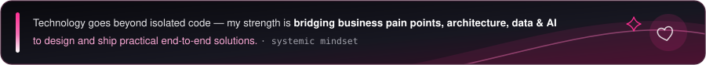
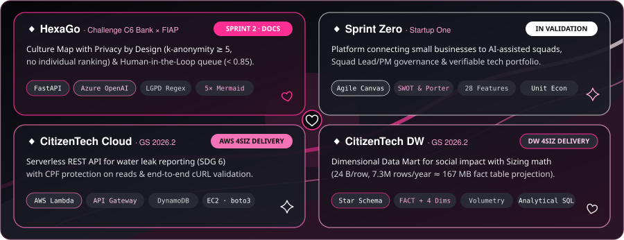
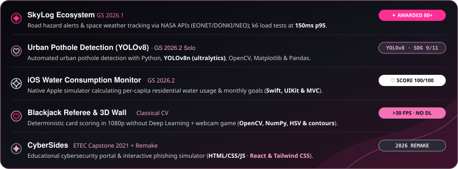
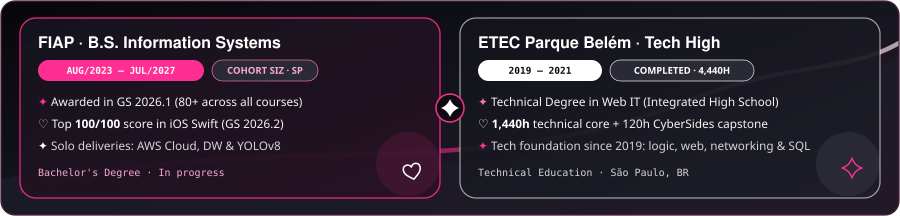

<div align="center">
  
</div>

<div align="center">
  <a href="https://github.com/euLuizinho"></a>
  <a href="./README.en.md"></a>
</div>

<div align="center">
  
</div>

<div align="center">
  <a href="https://www.linkedin.com/in/euLuizFabiano"></a>
  <a href="mailto:eufabianoluiz@gmail.com"></a>
  <a href="https://github.com/euLuizinho"></a>
  
  
</div>

<br>

### ✦ `> whoami`

```json
{
  "name": "Luiz Fabiano",
  "handle": "@euLuizinho",
  "education": "B.S. Information Systems (FIAP • Jul/2027) & ETEC Tech",
  "current_focus": [
    "Applied AI & Agents",
    "Tech Product & Business",
    "Data Analytics / BI",
    "Automation & Cloud Ops"
  ],
  "technical_base": ["Logic", "SQL", "Python", "Kotlin", "Java", "Flutter", "Swift"],
  "mindset": "From infrastructure to business — understanding how every piece connects.",
  "languages": ["Portuguese (Native)", "English (Technical Reading)"]
}
```

<div align="center">
  
</div>

<div align="center">
  
</div>

<br>
<div align="center"></div>
<br>

### ♡ `> cat skills.txt`

<div align="center">
  <p>
    
  </p>
  
  
  
  
  
  
  
  

  <br><br>

  <p>
    
  </p>
  
  
  
  
  
  
  
  

  <br><br>
  <a href="https://skillicons.dev">
    
  </a>
</div>

<br>
<div align="center"></div>
<br>

### ✦ `> ls ./portfolio`

<div align="center">
  
</div>

<br>

<div align="center">
  
</div>

<div align="center">
  <a href="https://github.com/euLuizinho/SkyLog-Kotlin"></a>
  <a href="https://github.com/Lucas-FP7/SkyLog"></a>
  <a href="https://github.com/euLuizinho/SkyLog-Flutter"></a>
  <a href="https://youtu.be/oWIz45x7whg"></a>
  <a href="https://github.com/euLuizinho/GS_Cognitive_1S"></a>
  <a href="https://github.com/euLuizinho/CP3_CognitiveComputing"></a>
</div>

<br>

<details>
<summary><code>&gt; cat ./portfolio/extras.log</code> — Additional academic projects</summary>

<br>


> *Future of Work* platform (upskilling and ethical AI recruiting for job-bias detection) built with 4 **Java Spring Boot** microservices, frontend, database, and Docker Compose.

</details>

<br>
<div align="center"></div>
<br>

### ♡ `> cat education.log`

<div align="center">
  
</div>

<br>

<details>
<summary><code>&gt; ls ./certificados</code> — Certifications &amp; complementary courses</summary>

<br>

<div align="center">
  
  
  
  
  
  
  
  
  
  
</div>

</details>

<br>
<div align="center"></div>
<br>

### ✦ `> now_playing --spotify`

<div align="center">
  <a href="https://open.spotify.com">
    
  </a>
</div>

<br>
<div align="center"></div>
<br>

### ♡ `> ./generate_snake.sh`

<div align="center">
  <picture>
    <source media="(prefers-color-scheme: dark)" srcset="https://raw.githubusercontent.com/euLuizinho/euLuizinho/output/github-snake-dark.svg" />
    <source media="(prefers-color-scheme: light)" srcset="https://raw.githubusercontent.com/euLuizinho/euLuizinho/output/github-snake.svg" />
    
  </picture>
</div>

<br>

<div align="center">
  
</div>
