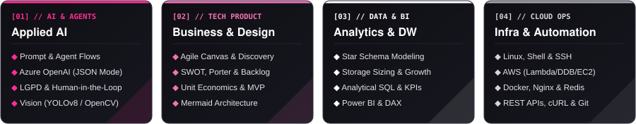

<div align="center">
  
</div>

<div align="center">
  <a href="https://github.com/euLuizinho"></a>
  <a href="./README.en.md"></a>
</div>

<div align="center">
  
</div>

<div align="center">
  <a href="https://www.linkedin.com/in/euLuizFabiano"></a>
  <a href="mailto:eufabianoluiz@gmail.com"></a>
  <a href="https://github.com/euLuizinho"></a>
  
  
</div>

<br>

### ✦ `> whoami`

```json
{
  "name": "Luiz Fabiano",
  "handle": "@euLuizinho",
  "education": "B.S. Information Systems (FIAP • Jul/2027) & ETEC Tech",
  "current_focus": [
    "Applied AI & Agents",
    "Tech Product & Business",
    "Data Analytics / BI",
    "Automation & Cloud Ops"
  ],
  "technical_base": ["Logic", "SQL", "Python", "Kotlin", "Java", "Flutter", "Swift"],
  "mindset": "From infrastructure to business — understanding how every piece connects.",
  "languages": ["Portuguese (Native)", "English (Technical Reading)"]
}
```

> I believe technology goes far beyond writing isolated code. My strength lies in **bridging business pain points, system architecture, data, cloud, and Applied AI** to design and ship end-to-end solutions.

<div align="center">
  
</div>

<br>
<div align="center"></div>
<br>

### ♡ `> cat skills.txt`

<div align="center">
  <p>
    <b>◆ Hands-on Autonomy</b> <sub><i>(direct operation, architecture &amp; technical defense)</i></sub>
  </p>
  
  
  
  
  
  
  
  

  <br><br>

  <p>
    <b>◇ Built in Projects</b> <sub><i>(applied in real deliverables &amp; continuous mastery)</i></sub>
  </p>
  
  
  
  
  
  
  
  

  <br><br>
  <a href="https://skillicons.dev">
    
  </a>
</div>

<br>
<div align="center"></div>
<br>

### ✦ `> ls ./portfolio`

| Project | Focus &amp; Impact | Architecture &amp; Stack | Status / Links |
| :--- | :--- | :--- | :--- |
| **◆ HexaGo** *(Challenge C6 Bank × FIAP)* | Culture Map with *Privacy by Design* (k-anonymity ≥ 5, no individual ranking) and *Human-in-the-Loop* review queue (`< 0.85`). | FastAPI, LGPD Sanitization (Regex + salted hash), Azure OpenAI (JSON Mode), React/Recharts, SQLite3 &amp; 5 Mermaid diagrams | *Sprint 2 · Documented* |
| **◆ Sprint Zero** *(FIAP Capstone • Startup One)* | Platform connecting small businesses to AI-assisted multidisciplinary squads, Squad Lead/PM role &amp; verifiable portfolio. | Product Strategy, SWOT, Porter's 5 Forces, Agile Canvas, 28 features (`F01`–`F28`), *Unit Economics* &amp; ABNT | *In validation* |
| **◆ CitizenTech Cloud** *(GS 2026.2 Solo · SDG 6)* | Serverless REST API for water leak reporting with CPF protection on reads and end-to-end `cURL` verification. | AWS Lambda (`boto3`/Python), API Gateway, DynamoDB (`ConditionExpression`) &amp; EC2 Ubuntu | *AWS 4SIZ Delivery* |
| **◆ CitizenTech DW** *(GS 2026.2 Solo · Analytics)* | Dimensional Data Mart for social impact with storage *Sizing* (24 B/row, 7.3M rows/year ≈ 167 MB projection). | *Star Schema* (`FATO_ATENDIMENTO` + 4 dims), Volumetry &amp; Analytical SQL | *DW 4SIZ Delivery* |
| **◇ Urban Pothole Detection (YOLOv8)** *(GS 2026.2 Solo)* | Automated urban pothole detection supporting municipal maintenance triage (SDGs 9 &amp; 11). | Python, YOLOv8n (`ultralytics`), OpenCV, Matplotlib &amp; Pandas | [`GS_Cognitive_1S`](https://github.com/euLuizinho/GS_Cognitive_1S) |
| **◇ iOS Water Consumption Monitor** *(GS 2026.2 · 100/100)* | Native Apple simulator calculating per-capita residential water usage and monthly goal projections. | Swift, UIKit, Storyboard &amp; MVC pattern | *Score 100/100* |
| **◇ SkyLog Ecosystem** *(GS 2026.1 · Awarded 80+)* | Road hazard alerts &amp; space weather tracking via NASA APIs (EONET/DONKI/NEO); k6 load tests at **150ms p95**. | Android (Kotlin/Compose/MVVM/Koin), FastAPI, RabbitMQ, Redis 7, Docker, Nginx &amp; Flutter/Firestore | [`Kotlin`](https://github.com/euLuizinho/SkyLog-Kotlin) · [`Cloud`](https://github.com/Lucas-FP7/SkyLog) · [`Flutter`](https://github.com/euLuizinho/SkyLog-Flutter) · [`Demo`](https://youtu.be/oWIz45x7whg) |
| **◇ Blackjack Referee &amp; 3D Wall** *(Classical CV)* | Deterministic card scoring at **&gt;30 FPS** in 1080p **without Deep Learning**, plus real-time webcam silhouette game. | Python, OpenCV, NumPy, HSV space, mathematical morphology &amp; contours | [`CP3_CognitiveComputing`](https://github.com/euLuizinho/CP3_CognitiveComputing) |
| **◇ CyberSides** *(ETEC Capstone 2021 + Remake)* | Educational cybersecurity portal featuring an interactive phishing detection simulator. | HTML/CSS/JS *(original)* · React &amp; Tailwind CSS *(2026 Remake)* | *2026 Remake* |

<details>
<summary><code>&gt; cat ./portfolio/extras.log</code> — Additional academic projects</summary>

- **TalentHub (GS 2025 — Private Repo `fiap-gs-2025-talenthub-14`):** *Future of Work* platform (upskilling and ethical AI recruiting for job-bias detection) built with 4 **Java Spring Boot** microservices, frontend, database, and Docker Compose.

</details>

<br>
<div align="center"></div>
<br>

### ♡ `> cat education.log`

| Degree / Program | Institution | Period | Highlights &amp; Foundation |
| :--- | :--- | :--- | :--- |
| **B.S. in Information Systems** | **FIAP** *(Cohort SIZ)* | Aug/2023 – Jul/2027 *(In progress)* | Awarded in GS 2026.1 (80+ across all courses), **100/100** score in iOS Swift (GS 2026.2), and solo deliveries in AWS Cloud, Data Warehousing &amp; YOLOv8. |
| **Technical Degree in Web IT** | **ETEC Parque Belém** | 2019 – 2021 *(Completed · 4,440h)* | Integrated High School + Technical program (1,440h technical + 120h *CyberSides* capstone), grounding logic, web, networking &amp; databases since 2019. |

<details>
<summary><code>&gt; ls ./certificados</code> — Certifications &amp; complementary courses</summary>

- **Full Cycle Tech Week: AI for Devs** — Full Cycle *(Jun/2026 · 8h)*
- **DevOps &amp; Agile Culture** — FIAP *(May/2026)*
- **IT Infrastructure Management** — FIAP *(May/2026)*
- **Computer Architecture &amp; Structures** — FIAP *(May/2026)*
- **Linux Fundamentals** — FIAP *(May/2025)*
- **Big Data** — FIAP *(May/2025)*
- **Career Accelerator with Power BI** — Daxus *(Jul/2024)*
- **Java Fundamentals** — FIAP *(May/2024)*
- **Learning How to Learn** — Alura *(Jul/2024)*
- **Social Formation &amp; Sustainability** — FIAP *(May/2024)*

</details>

<br>
<div align="center"></div>
<br>

### ✦ `> now_playing --spotify`

<div align="center">
  <a href="https://open.spotify.com">
    
  </a>
</div>

<br>
<div align="center"></div>
<br>

### ♡ `> ./generate_snake.sh`

<div align="center">
  <picture>
    <source media="(prefers-color-scheme: dark)" srcset="https://raw.githubusercontent.com/euLuizinho/euLuizinho/output/github-snake-dark.svg" />
    <source media="(prefers-color-scheme: light)" srcset="https://raw.githubusercontent.com/euLuizinho/euLuizinho/output/github-snake.svg" />
    
  </picture>
</div>

<br>

<div align="center">
  
</div>
