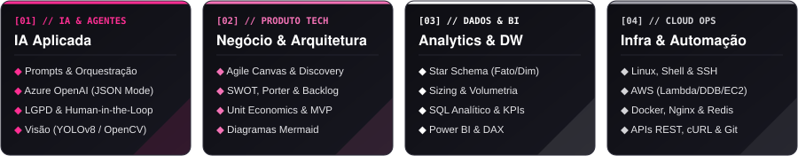

<div align="center">
  
</div>

<div align="center">
  <a href="./README.md"></a>
  <a href="./README.en.md"></a>
</div>

<div align="center">
  
</div>

<div align="center">
  <a href="https://www.linkedin.com/in/euLuizFabiano"></a>
  <a href="mailto:eufabianoluiz@gmail.com"></a>
  <a href="https://github.com/euLuizinho"></a>
  
  
</div>

<br>

### ✦ `01 // > whoami`

```json
{
  "nome": "Luiz Fabiano",
  "usuario": "@euLuizinho",
  "formacao": "Sistemas de Informação (FIAP • Jul/2027) & Técnico ETEC",
  "foco_atual": [
    "IA Aplicada & Agentes",
    "Produto & Negócios Tech",
    "Análise de Dados / BI",
    "Automação & Cloud Ops"
  ],
  "base_tecnica": ["Lógica", "SQL", "Python", "Kotlin", "Java", "Flutter", "Swift"],
  "mindset": "Da infraestrutura ao negócio — entendendo como as peças se conectam.",
  "idiomas": ["Português (Nativo)", "Inglês (Leitura Técnica)"]
}
```

> Acredito que tecnologia vai muito além de escrever código isolado. Meu diferencial está em **conectar dor de negócio, arquitetura de sistemas, dados, nuvem e Inteligência Artificial** para tirar produtos e automações do papel de ponta a ponta.

<div align="center">
  
</div>

<br>
<div align="center"></div>
<br>

### ✦ `02 // > cat skills.txt`

<div align="center">
  <p>
    <b>◆ Autonomia Prática</b> <sub><i>(operação direta, arquitetura &amp; defesa técnica)</i></sub>
  </p>
  
  
  
  
  
  
  
  

  <br><br>

  <p>
    <b>◇ Construído em Projetos</b> <sub><i>(aplicado em entregas reais &amp; consolidação contínua)</i></sub>
  </p>
  
  
  
  
  
  
  
  

  <br><br>
  <a href="https://skillicons.dev">
    
  </a>
</div>

<br>
<div align="center"></div>
<br>

### ✦ `03 // > ls ./portfolio`

| Projeto | Foco &amp; Impacto | Arquitetura &amp; Stack | Status / Links |
| :--- | :--- | :--- | :--- |
| **◆ HexaGo** *(Challenge C6 Bank × FIAP)* | Mapa de Cultura com *Privacy by Design* (k-anonimato ≥ 5, vedação de ranking individual) e fila *Human-in-the-Loop* (`< 0.85`). | FastAPI, Sanitização LGPD (Regex + hash salgado), Azure OpenAI (JSON Mode), React/Recharts, SQLite3 &amp; 5 diagramas Mermaid | *Sprint 2 · Documentado* |
| **◆ Sprint Zero** *(TCC FIAP • Startup One)* | Plataforma conectando pequenos negócios a squads multidisciplinares com IA, papel de Squad Lead/GP e portfólio verificável. | Produto, SWOT, 5 Forças de Porter, Agile Canvas, 28 features (`F01`–`F28`), *Unit Economics* &amp; ABNT | *Em validação* |
| **◆ CitizenTech Cloud** *(GS 2026.2 Solo · ODS 6)* | API REST Serverless de denúncias de vazamento de água com proteção de CPF nas leituras e testes ponta a ponta via `cURL`. | AWS Lambda (`boto3`/Python), API Gateway, DynamoDB (`ConditionExpression`) &amp; EC2 Ubuntu | *Entrega AWS 4SIZ* |
| **◆ CitizenTech DW** *(GS 2026.2 Solo · Analytics)* | Data Mart dimensional para impacto social com cálculo de *Sizing* (24 B/linha, projeção 7,3M linhas/ano ≈ 167 MB). | Modelagem *Star Schema* (`FATO_ATENDIMENTO` + 4 dims), Volumetria &amp; SQL Analítico | *Entrega DW 4SIZ* |
| **◇ Zeladoria Urbana (YOLOv8)** *(GS 2026.2 Solo)* | Detecção automatizada de buracos em vias urbanas para apoio à triagem municipal (ODS 9 e 11). | Python, YOLOv8n (`ultralytics`), OpenCV, Matplotlib &amp; Pandas | [`GS_Cognitive_1S`](https://github.com/euLuizinho/GS_Cognitive_1S) |
| **◇ Monitor Hídrico iOS** *(GS 2026.2 · Nota 100/100)* | Simulador residencial de consumo de água per capita e projeção de metas em ambiente nativo Apple. | Swift, UIKit, Storyboard &amp; padrão MVC | *Nota 100/100* |
| **◇ SkyLog Ecosystem** *(GS 2026.1 · Premiado 80+)* | Alertas rodoviários e monitoramento espacial via APIs da NASA (EONET/DONKI/NEO); carga k6 com **p95 de 150ms**. | Android (Kotlin/Compose/MVVM/Koin), FastAPI, RabbitMQ, Redis 7, Docker, Nginx &amp; Flutter/Firestore | [`Kotlin`](https://github.com/euLuizinho/SkyLog-Kotlin) · [`Cloud`](https://github.com/Lucas-FP7/SkyLog) · [`Flutter`](https://github.com/euLuizinho/SkyLog-Flutter) · [`Demo`](https://youtu.be/oWIz45x7whg) |
| **◇ PDI Blackjack &amp; Muro 3D** *(Visão Clássica)* | Arbitragem determinística de cartas a **&gt;30 FPS** em 1080p **sem Deep Learning**, mais jogo via webcam em tempo real. | Python, OpenCV, NumPy, espaço HSV, morfologia matemática &amp; contornos | [`CP3_CognitiveComputing`](https://github.com/euLuizinho/CP3_CognitiveComputing) |
| **◇ CyberSides** *(TCC ETEC 2021 + Remake)* | Portal educativo de cibersegurança com simulador interativo de detecção de phishing. | HTML/CSS/JS *(original)* · React &amp; Tailwind CSS *(Remake 2026)* | *Remake 2026* |

<details>
<summary><code>&gt; cat ./portfolio/extras.log</code> — Projetos complementares de formação</summary>

- **TalentHub (GS 2025 — Repo Privado `fiap-gs-2025-talenthub-14`):** plataforma para *Future of Work* (upskilling e recrutamento ético com IA para detecção de viés em vagas), estruturada com 4 microsserviços em **Java Spring Boot**, frontend, banco de dados e Docker Compose.

</details>

<br>
<div align="center"></div>
<br>

### ✦ `04 // > cat education.log`

| Formação | Instituição | Período | Destaques &amp; Base |
| :--- | :--- | :--- | :--- |
| **Bacharelado em Sistemas de Informação** | **FIAP** *(Turma SIZ)* | Ago/2023 – Jul/2027 *(Em andamento)* | Premiado na GS 2026.1 (80+ em todas as disciplinas), nota **100/100** em iOS Swift (GS 2026.2) e entregas individuais em Cloud AWS, DW e YOLOv8. |
| **Técnico em Informática para Internet** | **ETEC Parque Belém** | 2019 – 2021 *(Concluído · 4.440h)* | Formação técnica integrada ao Ensino Médio (1.440h técnicas + 120h TCC *CyberSides*), consolidando lógica, web, redes e bancos de dados desde 2019. |

<details>
<summary><code>&gt; ls ./certificados</code> — Certificações &amp; cursos complementares</summary>

- **Full Cycle Tech Week: AI for Devs** — Full Cycle *(Jun/2026 · 8h)*
- **DevOps &amp; Agile Culture** — FIAP *(Mai/2026)*
- **Gestão de Infraestrutura de TI** — FIAP *(Mai/2026)*
- **Estruturas de Computadores** — FIAP *(Mai/2026)*
- **Linux Fundamentos** — FIAP *(Mai/2025)*
- **Big Data** — FIAP *(Mai/2025)*
- **Acelerador de Carreira com Power BI** — Daxus *(Jul/2024)*
- **Java Fundamentos** — FIAP *(Mai/2024)*
- **Aprender a Aprender: Técnicas para seu Autodesenvolvimento** — Alura *(Jul/2024)*
- **Formação Social e Sustentabilidade** — FIAP *(Mai/2024)*

</details>

<br>
<div align="center"></div>
<br>

### ✦ `05 // > now_playing --spotify`

<div align="center">
  <a href="https://open.spotify.com">
    
  </a>
</div>

<br>
<div align="center"></div>
<br>

### ✦ `06 // > ./generate_snake.sh`

<div align="center">
  <picture>
    <source media="(prefers-color-scheme: dark)" srcset="https://raw.githubusercontent.com/euLuizinho/euLuizinho/output/github-snake-dark.svg" />
    <source media="(prefers-color-scheme: light)" srcset="https://raw.githubusercontent.com/euLuizinho/euLuizinho/output/github-snake.svg" />
    
  </picture>
</div>

<br>

<div align="center">
  
</div>
