<div align="center">
  
</div>

<div align="center">
  
</div>

<div align="center">
  <a href="https://linkedin.com/in/euLuizFabiano"></a>
  <a href="mailto:eufabianoluiz@gmail.com"></a>
  <a href="https://github.com/euLuizinho"></a>
  
  
</div>

<br>

### ♠️ `> whoami`

```json
{
  "nome": "Luiz Fabiano",
  "apelido": "Luizinho (@euLuizinho)",
  "formacao": "Sistemas de Informação (FIAP • Formatura Jul/2027) & Técnico ETEC",
  "vivencia_corporativa": "Operação de Varejo, Estoque, Vendas & Rotinas Adm (Arezzo&Co)",
  "foco_atual": ["IA Aplicada & Agentes", "Produto Tech & Negócios", "Dados/BI & Cloud Ops"],
  "base_tecnica": ["Lógica de Programação", "Python", "SQL", "Kotlin", "Flutter", "Java", "Swift"],
  "mindset": "Da infraestrutura ao negócio — entendendo como as peças se conectam.",
  "pronomes": "ele/dele"
}
```

> Acredito que o papel de quem trabalha com tecnologia vai muito além de escrever código isolado. Tenho base em lógica de programação e contato prático com múltiplas stacks — mas meu diferencial está em **conectar dor de negócio, arquitetura, dados, nuvem e Inteligência Artificial** para tirar produtos e automações do papel de ponta a ponta.

<br>
<div align="center"></div>
<br>

### ♣️ `> cat skills.txt`

<div align="center">
  <p><b>Frentes Principais &amp; Diferenciais</b></p>
  
  
  
  
  
  
  <br><br>
  <p><b>Ecossistema &amp; Tecnologias Exploradas em Projetos</b></p>
  <a href="https://skillicons.dev">
    
  </a>
</div>

<br>
<div align="center"></div>
<br>

### ♦️ `> ls ./portfolio`

| Projeto | Foco &amp; Contexto | Tecnologias &amp; Arquitetura | Links |
| :--- | :--- | :--- | :--- |
| **🃏 Sprint Zero** *(TCC FIAP • Startup One)* | Plataforma de squads reais e portfólio verificável conectando iniciantes em TI e pequenos negócios *(em validação)* | Produto, SWOT, Porter, Agile Canvas, 28 features (MVP), Squad Lead/GP &amp; Unit Economics | *Em validação* |
| **🏦 HexaGo** *(Challenge C6 Bank × FIAP)* | Mapa de Cultura com *Privacy by Design* e IA sem vigilância individual *(Sprint 2 concluído)* | FastAPI, Sanitização LGPD, k-anonimato, Azure OpenAI (JSON Mode), Human-in-the-Loop, React/Recharts, Mermaid | *Sprint 2* |
| **🛰️ SkyLog Ecosystem** *(GS 2026.1 • Premiado 80+)* | Monitoramento de desastres e rotas seguras integrado às APIs da NASA (EONET/DONKI/NEO) | Android (Kotlin/Compose/MVVM), Backend (FastAPI/RabbitMQ/Redis/Docker/Nginx/k6) &amp; Flutter/Firestore | [`Kotlin`](https://github.com/euLuizinho/SkyLog-Kotlin) · [`Cloud`](https://github.com/Lucas-FP7/SkyLog) · [`Flutter`](https://github.com/euLuizinho/SkyLog-Flutter) · [`Demo`](https://youtu.be/oWIz45x7whg) |
| **🌍 CitizenTech — Visão &amp; Cloud** *(GS 2026.2 Solo)* | Zeladoria urbana (detecção de buracos em vias) &amp; denúncias serverless de vazamento de água (ODS 6, 9 e 11) | YOLOv8n (`ultralytics`), OpenCV, AWS Lambda (`boto3`), API Gateway, DynamoDB &amp; EC2 Ubuntu | [`GS_Cognitive_1S`](https://github.com/euLuizinho/GS_Cognitive_1S) |
| **📊 CitizenTech — DW &amp; iOS** *(GS 2026.2 Solo)* | Modelagem analítica de impacto social + App iOS de consumo residencial de água *(nota 100/100)* | Data Warehouse (*Star Schema*, Sizing/Volumetria, SQL Analítico) &amp; Swift/UIKit/Storyboard (MVC) | *Entregas 4SIZ* |
| **🎴 PDI &amp; Visão Clássica** *(Computação Cognitiva)* | Arbitragem de Blackjack a >30 FPS sem Deep Learning &amp; jogo em tempo real *Muro Humano 3D* | Python, OpenCV, NumPy, HSV, Morfologia Matemática &amp; Contornos | [`CP3_CognitiveComputing`](https://github.com/euLuizinho/CP3_CognitiveComputing) |
| **🛡️ CyberSides** *(TCC ETEC 2021 + Remake)* | Portal educativo de cibersegurança com simulador interativo de detecção de phishing | HTML/CSS/JS *(original)* · React &amp; Tailwind CSS *(Remake 2026 em evolução)* | *Em evolução* |

<br>
<div align="center"></div>
<br>

### ♥️ `> now_playing --spotify`

<div align="center">
  
</div>

<br>
<div align="center"></div>
<br>

### 🃏 `> ./generate_snake.sh`

<div align="center">
  <picture>
    <source media="(prefers-color-scheme: dark)" srcset="https://raw.githubusercontent.com/euLuizinho/euLuizinho/output/github-snake-dark.svg">
    <source media="(prefers-color-scheme: light)" srcset="https://raw.githubusercontent.com/euLuizinho/euLuizinho/output/github-snake-dark.svg">
    
  </picture>
</div>

<br>

<div align="center">
  
</div>
